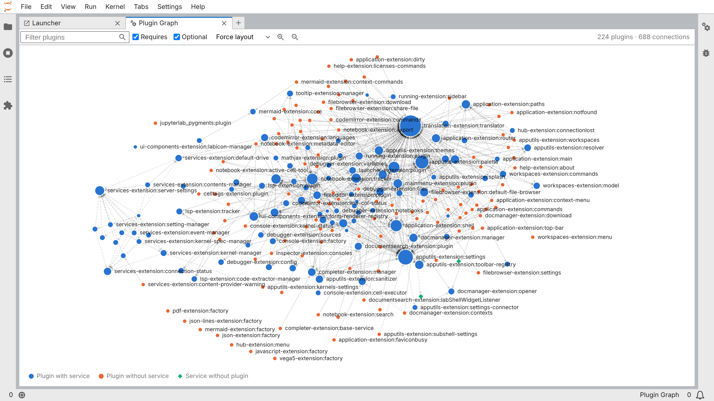

# jupyterlab-plugin-graph

[](https://jupyterlab-contrib.github.io/)
[](https://github.com/jupyterlab-contrib/jupyterlab-plugin-graph/actions/workflows/build.yml)
[](https://mybinder.org/v2/gh/jupyterlab-contrib/jupyterlab-plugin-graph/main?urlpath=lab)

JupyterLab extension to show an interactive dependency graph of all the installed plugins.



## Usage

Select `Plugin Dependency Graph` in the Help menu, or run it from the command palette.

- A node is a plugin. Its size shows how many plugins use its service.
- An edge goes from a plugin to a service that it uses. A solid line is a required dependency, a dashed line is an optional dependency.
- Move the pointer on a node to highlight its dependencies and see its details.
- Click a node, or type in the filter, to show only a plugin and its neighbors.
- Use the mouse wheel or the toolbar buttons to zoom, and drag the background to pan.
- Select the force layout or the circular layout in the toolbar.

## Requirements

- JupyterLab >= 4.1

## Install

To install the extension, execute:

```bash
pip install jupyterlab-plugin-graph
```

## Uninstall

To remove the extension, execute:

```bash
pip uninstall jupyterlab-plugin-graph
```

## Contributing

If you would like to contribute to this extension, please refer to the [Contributing Guide](CONTRIBUTING.md).
